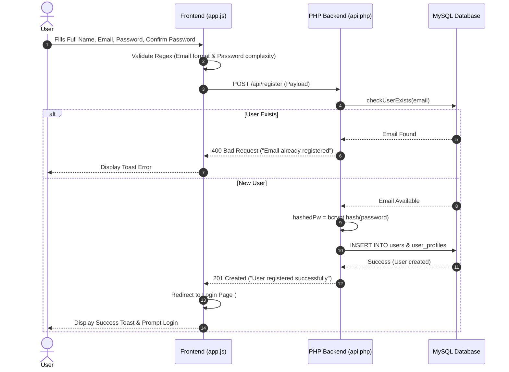
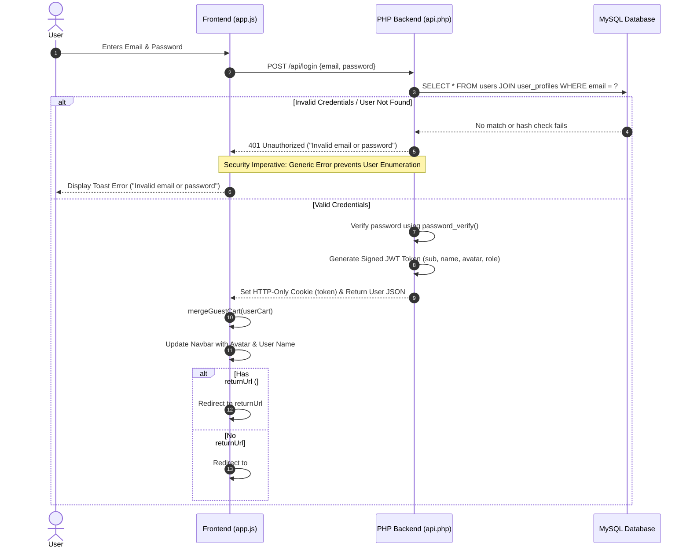
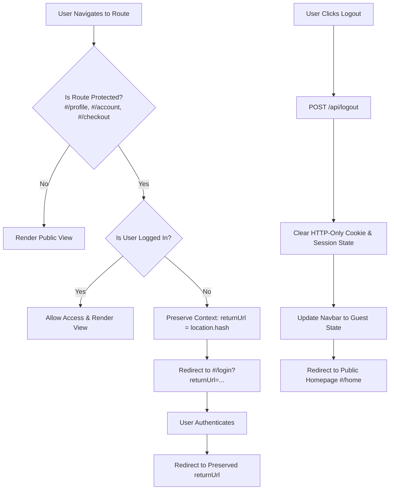

# Week 6 Lab Diary: User Authentication & Profile Management

**Course:** ICT2142 E-Business Systems  
**Phase:** Core Development — User Authentication & Security Implementation  
**Project:** NoFrame E-Commerce Web System  

---

## 1. Authentication Architecture & Visual Flow Diagrams

### 1.1 User Registration & Password Hashing Lifecycle


### 1.2 User Login, JWT Cookie Issuance & Cart Association Flow


### 1.3 Route Protection & Logout Sequence


---

## 2. Security Considerations & Best Practices

### 2.1 Password Hashing with Bcrypt
- **Imperative**: Plaintext passwords must NEVER be stored in the database or transmitted in plain logs.
- **Implementation**: The backend uses native PHP `password_hash($password, PASSWORD_BCRYPT)` with default cost factor.
- **Verification**: User logins call `password_verify($password, $user['password_hash'])` to safely verify credentials against timing attacks.

### 2.2 Prevention of User Enumeration
- **Imperative**: Malicious actors must not be able to guess registered email addresses by examining subtle differences in error messages.
- **Implementation**: In `POST /api/login`, whether the email does not exist or the password does not match, the API uniformly returns:
  ```json
  {
    "ok": false,
    "success": false,
    "message": "Invalid email or password"
  }
  ```

### 2.3 JWT Token & Cookie Safety
- **JWT Payload Structure**:
  ```json
  {
    "sub": "U1",
    "name": "Dev Student",
    "avatar": "/assets/u1.svg",
    "role": "authenticated",
    "iat": 1790615181,
    "exp": 1790701581
  }
  ```
- **Cookie Security**: Tokens are issued via HTTP-only cookies (`Set-Cookie: token=...; HttpOnly; SameSite=Lax; Path=/`), preventing Client XSS scripts from stealing raw access tokens.

---

## 3. API Specification — Week 6 Endpoints

### 3.1 User Registration: `POST /api/register`
- **Request Body**:
  ```json
  {
    "name": "Dev Student",
    "email": "user_882@devlab.io",
    "password": "Password123!",
    "confirm_password": "Password123!",
    "phone": "+94 77 123 4567"
  }
  ```
- **Validation Rules**:
  - Email format regex (`filter_var(..., FILTER_VALIDATE_EMAIL)`).
  - Password complexity: Minimum 8 characters, at least 1 uppercase letter, 1 lowercase letter, 1 number, and 1 special character.
  - Password matching verification (`password === confirm_password`).
- **Response (201 Created)**:
  ```json
  {
    "ok": true,
    "success": true,
    "message": "User registered successfully",
    "userId": "U65f9a12b"
  }
  ```

### 3.2 User Login: `POST /api/login`
- **Request Body**:
  ```json
  {
    "email": "user_882@devlab.io",
    "password": "Password123!"
  }
  ```
- **Response (200 OK)**:
  ```json
  {
    "ok": true,
    "success": true,
    "message": "Logged in successfully",
    "token": "eyJhbGciOiJIUzI1NiIsInR5cCI6IkpXVCJ9...",
    "user": {
      "id": "U1",
      "name": "Dev Student",
      "email": "user_882@devlab.io",
      "role": "customer",
      "phone": "+94 77 123 4567",
      "shippingAddress": "128 Galle Road, Colombo 03",
      "billingAddress": "128 Galle Road, Colombo 03",
      "avatar": "/assets/u1.svg",
      "accountStatus": "Active Member"
    }
  }
  ```

### 3.3 User Profile Management: `GET / POST /api/profile`
- **Headers / Cookie**: `Authorization: Bearer <token>` or `Cookie: token=<jwt>`
- **Request Body (POST Update)**:
  ```json
  {
    "name": "Dev Student",
    "phone": "+94 77 987 6543",
    "shipping_address": "45 Flower Road, Colombo 07",
    "billing_address": "45 Flower Road, Colombo 07"
  }
  ```
- **Response (200 OK)**: Returns updated user profile JSON object.

### 3.4 Identity Re-Verification & Password Change: `POST /api/change-password`
- **Request Body**:
  ```json
  {
    "current_password": "Password123!",
    "new_password": "NewSecretPass123!",
    "confirm_new_password": "NewSecretPass123!"
  }
  ```
- **Response (200 OK)**:
  ```json
  {
    "ok": true,
    "success": true,
    "message": "Password changed successfully"
  }
  ```

### 3.5 Session Termination: `POST /api/logout`
- **Response (200 OK)**:
  ```json
  {
    "ok": true,
    "success": true,
    "message": "Logged out successfully"
  }
  ```

---

## 4. Debugging Notes & Resolution Steps

| Issue / Edge Case Observed | Cause | Resolution Step Taken |
| :--- | :--- | :--- |
| **Password complexity failure on valid passwords** | Special character regex omitted hyphens or brackets. | Updated regex pattern to `/([@$!%*?&#^()_+\-=\[\]{};':"\\|,.<>\/?])/` covering all standard ASCII special symbols. |
| **Guest cart items lost after logging in** | Logging in replaced `SESSION.cart` directly with user's saved cart array. | Created `mergeGuestCart()` function that iterates through guest items and sums quantities (`qty`) before updating session. |
| **Redirect after login dropped target context** | Router navigated directly to `#/profile` regardless of initial destination. | Appended `?returnUrl=` parameter to login route (`#/login?returnUrl=%2Fcheckout`), allowing `doLogin()` to return the user directly to checkout. |
| **User enumeration vulnerability** | Login API returned "Email not found" vs "Wrong password". | Replaced distinct error messages with generic `"Invalid email or password"` for all failed login attempts. |
